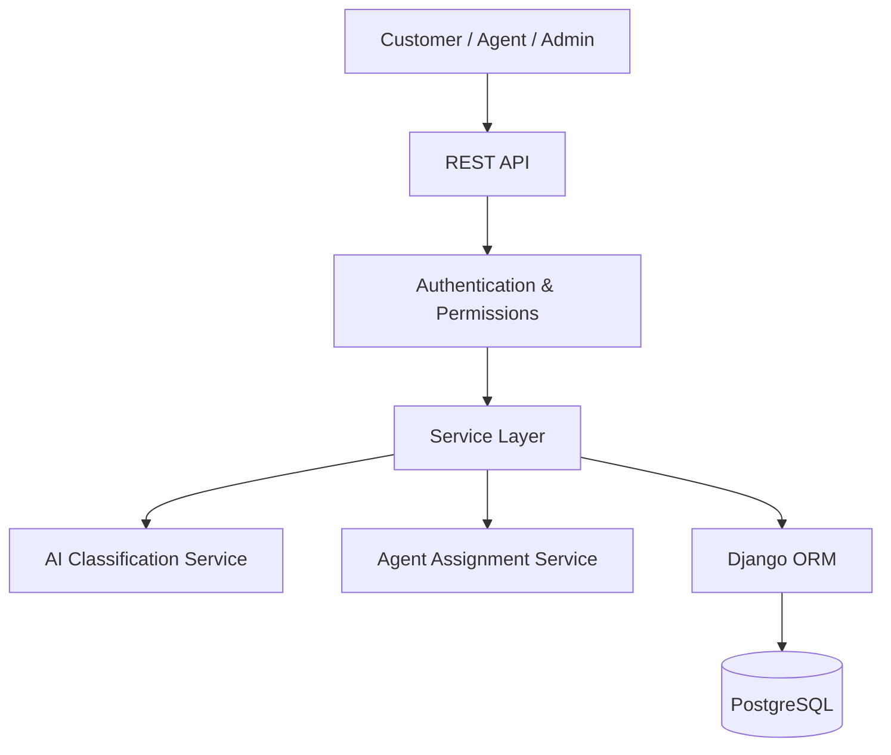

# SmartDesk

### AI-Powered Customer Support Ticket Management System

SmartDesk is a backend application designed to streamline customer support operations through automated ticket classification, priority prediction, agent assignment, and ticket lifecycle management.

The system uses Natural Language Processing (NLP) and Machine Learning to analyze customer support requests and assist support teams in handling tickets efficiently.

**Project Status:** Initial development

## Project Objectives

- Provide secure customer and agent authentication.
- Create and manage customer support tickets.
- Automatically classify tickets using NLP.
- Predict ticket priority using machine learning.
- Assign tickets to appropriate support agents.
- Track ticket status throughout its lifecycle.
- Provide search, filtering, pagination, and analytics.

## Technology Stack

| Technology | Purpose |
|---|---|
| Python 3.12 | Backend programming |
| Django | Backend framework |
| Django REST Framework | REST API development |
| PostgreSQL | Relational database |
| Django ORM | Database operations |
| Simple JWT | Authentication |
| Scikit-learn | Machine learning |
| Pytest | Automated testing |
| Swagger / OpenAPI | API documentation |
| Docker | Containerization |
| Git & GitHub | Version control |

## High-Level Architecture



## Planned Modules

1. User Management
2. Ticket Management
3. AI-Based Classification
4. Agent Management
5. Ticket Lifecycle Management
6. Search and Analytics
7. API Documentation
8. Automated Testing

## Ticket Lifecycle

OPEN → ASSIGNED → IN_PROGRESS → RESOLVED → CLOSED

## User Roles

- ADMIN: Manage users, agents, and tickets.
- AGENT: Handle assigned support tickets.
- CUSTOMER: Create and track support tickets.

## Repository Structure

```text
SmartDesk/
├── .gitignore
├── README.md
├── requirements.txt
├── .env.example
├── docs/
├── src/
└── tests/
```

The repository structure will evolve as development progresses.

## Development Principles

- Modular architecture
- Separation of concerns
- Secure authentication and authorization
- Input validation
- Reusable business services
- Automated testing
- Environment-based configuration
- Meaningful Git commit history

## Development Roadmap

- [x] Environment verification
- [x] Project workspace creation
- [ ] Repository initialization
- [ ] Custom user authentication
- [ ] Ticket management APIs
- [ ] AI-based ticket classification
- [ ] Agent assignment
- [ ] Ticket lifecycle management
- [ ] Search and analytics
- [ ] Automated testing
- [ ] Swagger documentation
- [ ] Docker configuration
- [ ] Deployment

## Project Setup

Installation and execution instructions will be added as the application development progresses.

## Author

Susanta Sekhar Palai

## License

MIT License (to be added).
```
